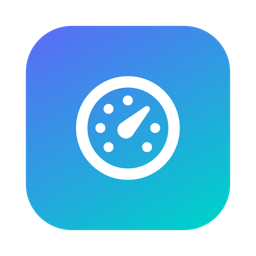
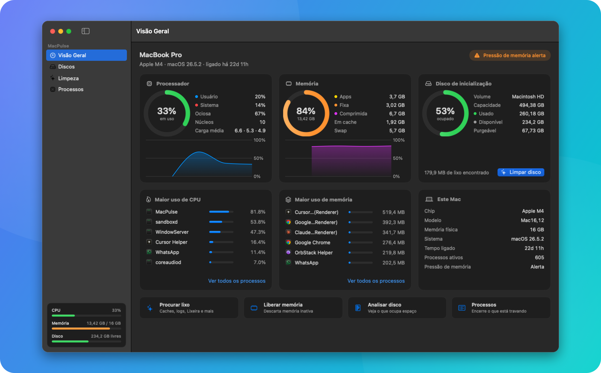
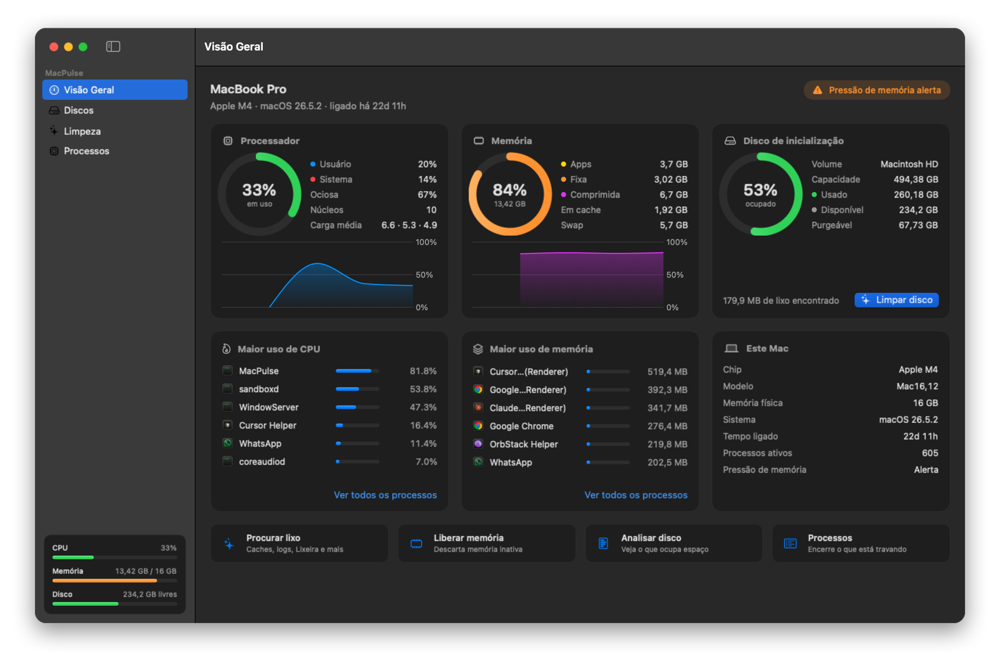
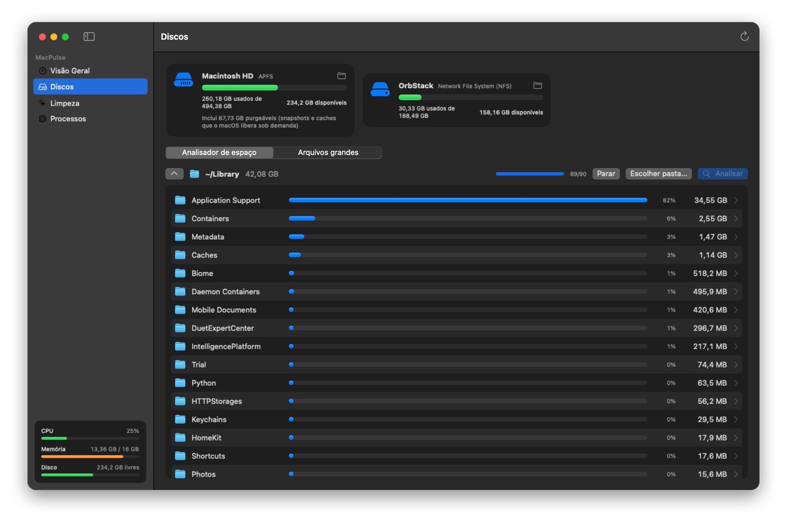
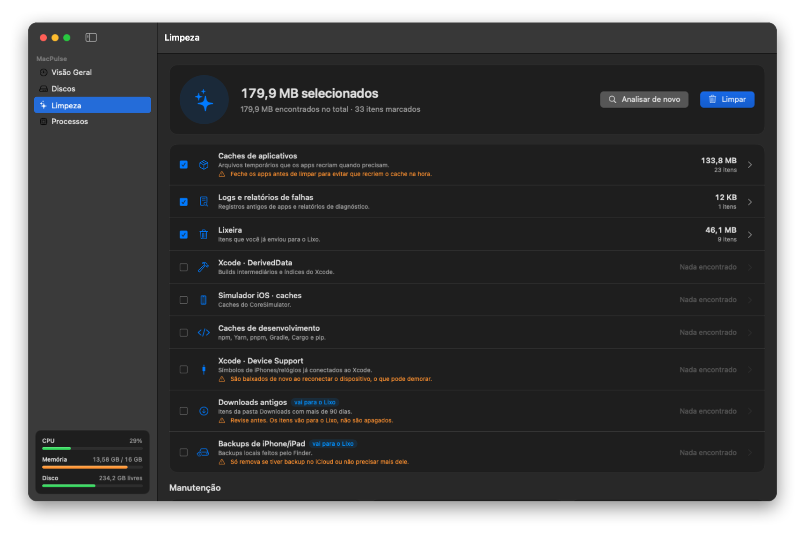
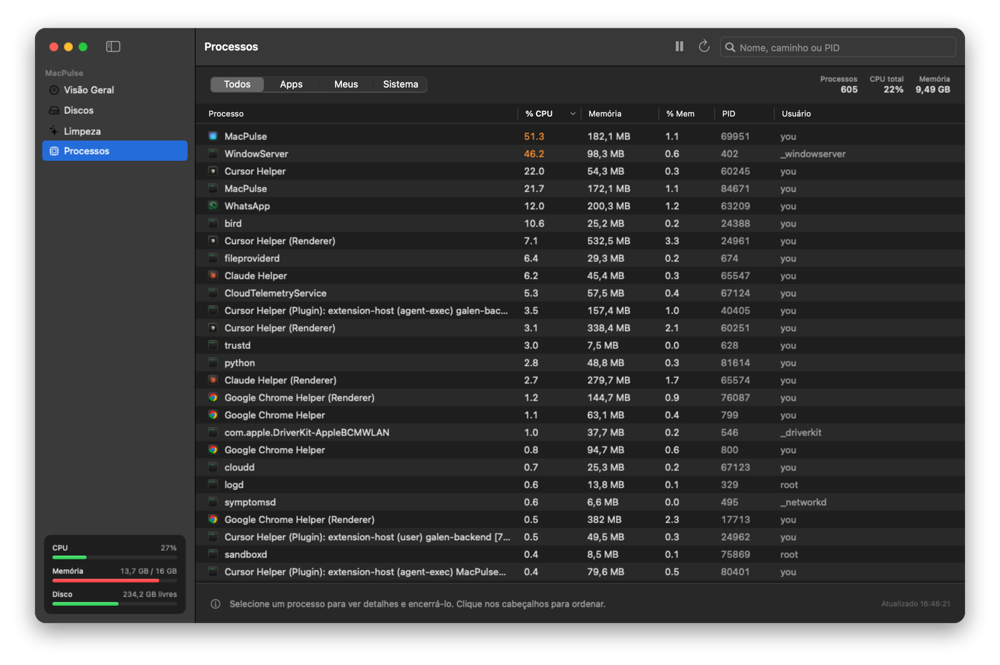

<div align="center">



# MacPulse

**See what is going on in your Mac, free up disk space, and stop the processes that slow it down.**

All in one native, lightweight app.


[**Features**](#features) · [**Install**](#install) · [**Share**](#share) · [**FAQ**](#faq) · [**Development**](#development)

<br>



</div>

<br>

## ✨ Why MacPulse

<table>
<tr>
<td width="33%" valign="top">

### 📊 Monitor
CPU, memory, disk and processes in real time. You get a health badge that warns you when something is off.

</td>
<td width="33%" valign="top">

### 🧹 Clean
Finds gigabytes of caches, logs, Xcode leftovers and dev package caches. You pick what to remove.

</td>
<td width="33%" valign="top">

### ⚡ Speed up
Quit apps that are hogging resources, free inactive memory and remove local Time Machine snapshots.

</td>
</tr>
</table>

<br>

<a name="features"></a>

## 🧭 Features

### 📊 Overview

Everything you need at a glance, refreshed every 1.5 seconds.



| | |
|---|---|
| 🧠 **Processor** | Usage split by user and system, load average and a live chart |
| 💾 **Memory** | Measured the same way Activity Monitor does it: app, wired, compressed, cached, swap and memory pressure |
| 💽 **Startup disk** | Used, available and *purgeable* space, with a shortcut to clean it |
| 🔥 **Top processes** | The six heaviest processes by CPU and by memory |
| 🩺 **Health badge** | Warns about high CPU, memory pressure or a nearly full disk |

<br>

### 💽 Disks

Find out exactly where your space went.



- 🗂️ **Volumes**: every mounted disk with capacity, free space and purgeable space. Eject external drives in one click.
- 📈 **Space analyzer**: the size of every item in a folder, sorted from largest to smallest. **Double-click** a folder to drill into it.
- 🐘 **Large files**: lists every file above 100 MB, 500 MB, 1 GB or 5 GB. Reveal it in Finder or move it to the Trash.

<br>

### 🧹 Cleanup

Scan, review, clean. Nothing is removed without your confirmation.



| | Category | Selected by default | What happens |
|:---:|---|:---:|---|
| 📦 | App caches · `~/Library/Caches` | ✅ | 🗑️ Deleted |
| 📄 | Logs and crash reports · `~/Library/Logs` | ✅ | 🗑️ Deleted |
| 🗑️ | Trash · `~/.Trash` | ✅ | 🗑️ Deleted |
| 🔨 | Xcode DerivedData | ✅ | 🗑️ Deleted |
| 📱 | iOS Simulator caches | ✅ | 🗑️ Deleted |
| 🧑‍💻 | Dev caches · npm, Yarn, pnpm, Gradle, Cargo, pip | ✅ | 🗑️ Deleted |
| 🔌 | Xcode Device Support | ⬜ | 🗑️ Deleted |
| ⬇️ | Downloads older than 90 days | ⬜ | ♻️ Moved to Trash |
| 📲 | iPhone/iPad backups | ⬜ | ♻️ Moved to Trash |

> [!TIP]
> Expand any category to choose item by item. Close your apps before cleaning their caches, otherwise they recreate them right away.

#### 🛠️ Maintenance

| | Action | What it does |
|:---:|---|---|
| 🧠 | **Free inactive memory** | Runs `purge` so macOS drops cached memory |
| 🌐 | **Flush DNS cache** | Fixes sites that will not load after network changes |
| 🗑️ | **Empty Trash via Finder** | Works even without Full Disk Access |
| 🕰️ | **Delete local Time Machine snapshots** | Frees "purgeable" space. Backups on your external drive are untouched |

> [!NOTE]
> Actions marked with 🔒 in the app ask for your administrator password through **macOS's own dialog**. MacPulse never sees it.

<br>

### ⚙️ Processes

The essentials of Activity Monitor, simpler and faster to use.



- 🔎 **Search** by name, path or PID
- 🏷️ **Filters**: All · Apps · Mine · System
- ↕️ **Sort** by any column: CPU, memory, PID, user
- 🛑 **Quit** or **force quit** any process. System processes can be terminated as administrator.
- 🛡️ **Protection**: essential processes (`kernel_task`, `launchd`, `WindowServer`, `loginwindow`…) are blocked so you cannot freeze your Mac by accident

<br>

### 🎛️ Menu bar

A small icon in the menu bar shows CPU, memory, disk and the top processes, one click away. It keeps running even after you close the main window.

> [!NOTE]
> The app's interface is in Brazilian Portuguese 🇧🇷.

<br>

<a name="install"></a>

## 📥 Install

> [!IMPORTANT]
> Requires **macOS 14 Sonoma or later** and **Xcode** or the **Command Line Tools** (`xcode-select --install`).

From the project folder, run:

```bash
make install
```

That is it: **MacPulse** is now in your Applications folder. 🎉

<details>
<summary><b>Other ways to run it</b></summary>

<br>

| Command | What it does |
|---|---|
| `make open` | Builds `dist/MacPulse.app` and opens it without installing |
| `make run` | Runs straight from SwiftPM (good for development) |
| Xcode | Open `Package.swift` and run the `MacPulse` target |

</details>

### 🔐 Recommended: grant Full Disk Access

Some folders, like the Trash, are protected by macOS. To let MacPulse scan everything:

1. Open **System Settings › Privacy & Security › Full Disk Access**
2. Click **+** and add **MacPulse** from Applications
3. Reopen MacPulse

> [!TIP]
> The **Abrir Ajustes** button in the Cleanup tab (*Limpeza*) takes you straight there.

<br>

<a name="share"></a>

## 📤 Share it with someone

```bash
make package
```

This creates two ready-to-send files in `dist/`. Both run on **Apple Silicon and Intel** Macs.

| File | Best for |
|---|---|
| 💿 `MacPulse-<version>.dmg` | The classic Mac installer: open it and drag MacPulse to Applications |
| 🗜️ `MacPulse-<version>.zip` | Email, Slack, Google Drive |

The version comes from `CFBundleShortVersionString` in [`Resources/Info.plist`](Resources/Info.plist).

### 👋 Opening it for the first time on another Mac

> [!WARNING]
> MacPulse is not notarized by Apple yet, so macOS blocks it the **first** time it is opened after a download. On macOS 15 Sequoia and later the message usually says **"MacPulse is damaged and can't be opened"**. The app is not damaged: this is the download quarantine. It takes one command and only happens once.

1. Drag **MacPulse** into **Applications**.
2. Open **Terminal** (Applications › Utilities), paste this and press Return:

   ```bash
   xattr -dr com.apple.quarantine /Applications/MacPulse.app
   ```

3. Open MacPulse as usual. 🎉

> [!TIP]
> These steps are also included in the DMG and the ZIP as **`Como abrir - How to open.txt`**, in Portuguese and English, so you can send the file as is.

<details>
<summary><b>The message says "Apple could not verify" instead</b></summary>

<br>

You can also allow it without Terminal: go to **System Settings › Privacy & Security**, scroll to the bottom and click **Open Anyway** next to the MacPulse message. This button does not show up when macOS says the app "is damaged". In that case, use the command above.

</details>

<details>
<summary><b>How do I remove this step for good?</b></summary>

<br>

Sign the app with a **Developer ID Application** certificate (Apple Developer Program, US$ 99/year) and notarize it with `xcrun notarytool`. After that, it opens on any Mac with no warnings.

</details>

<br>

<a name="faq"></a>

## ❓ FAQ

<details>
<summary><b>Is it safe to delete caches?</b></summary>

<br>

Yes. Caches are temporary files that apps recreate whenever they need them. The only side effect is that an app might take a moment longer to open the first time afterwards. Sensitive system entries (iCloud, Keychain, Home) are always skipped.

</details>

<details>
<summary><b>Can I recover something I cleaned?</b></summary>

<br>

Downloads and iPhone backups go to the **Trash**, so you can restore them until you empty it. Caches, logs and build artifacts are deleted for good, since they regenerate on their own.

</details>

<details>
<summary><b>What is "purgeable" space?</b></summary>

<br>

Space taken by local Time Machine snapshots and caches that macOS frees automatically when it needs room. Finder counts it as "available". MacPulse shows it separately and can delete the snapshots on demand.

</details>

<details>
<summary><b>Why does the Trash say "Sem acesso" (no access)?</b></summary>

<br>

macOS protects the Trash folder. Grant **Full Disk Access** (see [Install](#install)), or use **Esvaziar Lixeira (via Finder)** in the Maintenance section (*Manutenção*), which works without it.

</details>

<details>
<summary><b>macOS says MacPulse "is damaged and can't be opened"</b></summary>

<br>

It is not damaged. macOS shows this for apps downloaded from the internet that are not notarized by Apple. Run `xattr -dr com.apple.quarantine /Applications/MacPulse.app` in Terminal once (see [Share](#share)).

</details>

<details>
<summary><b>I rebuilt the app and Full Disk Access stopped working</b></summary>

<br>

Each build gets a new ad-hoc signature, and macOS ties permissions to the signature. Remove MacPulse from the Full Disk Access list and add it again.

</details>

<details>
<summary><b>Does MacPulse send any data anywhere?</b></summary>

<br>

No. Everything runs locally, and the app makes no network connections.

</details>

<br>

<a name="development"></a>

## 🛠️ Development

### Commands

| Command | Description |
|---|---|
| `make build` | Debug build |
| `make run` | Build and run with SwiftPM |
| `make app` | Universal release build at `dist/MacPulse.app` |
| `make open` | `make app` + open the app |
| `make install` | `make app` + copy to `/Applications` |
| `make package` | `make app` + `.dmg` and `.zip` in `dist/` |
| `make screenshots` | Recaptures every tab and regenerates the images in `docs/images/` |
| `make clean` | Removes `.build/` and `dist/` |

### Project structure

```
MacPulse/
├── Sources/MacPulse/
│   ├── App/          🚪 Entry point, main window, menu bar, screenshot mode
│   ├── Services/     🔧 CPU/memory (Mach APIs), volumes, ps, file scanning, cleanup targets
│   ├── Stores/       🗃️ Observable state (@Observable) for each area
│   ├── Components/   🧩 Cards, gauges, bars, charts
│   └── Views/        🖼️ Overview, Disks, Cleanup, Processes
├── Resources/        🎨 Info.plist and app icon
├── scripts/          📜 build, packaging, icon and screenshot tooling
└── docs/images/      📸 README images
```

### 📸 Screenshots

`make screenshots` opens the app in a special debug mode. It walks through every tab, saves a 2x PNG of each one and closes by itself. Your computer name and user name are masked automatically.

<br>

## 🛡️ Safety

- ✅ **Nothing is removed without confirmation**
- 🗑️ Only data that regenerates (caches, logs, build artifacts) is deleted outright. Everything else goes to the Trash.
- 🚫 Sensitive iCloud, Keychain and Home entries in `~/Library/Caches` are always skipped
- 🔑 Administrator actions use the native macOS dialog. The app never handles your password.
- 📴 100% local: no network access, no telemetry

<br>

<div align="center">

Made with ❤️ and SwiftUI for macOS

</div>
